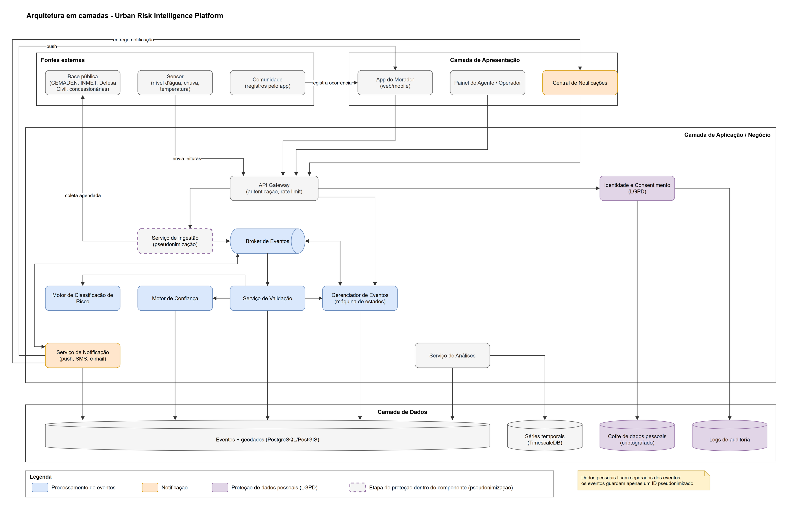

# Arquitetura em camadas

**Urban Risk Intelligence Platform** · Diagrama-fonte: [diagramas/arquitetura.drawio](diagramas/arquitetura.drawio)
(editável no draw.io)

**Legenda de cores:** azul = processamento de eventos · laranja = notificação · roxo = proteção de
dados pessoais (LGPD). A borda roxa tracejada no Serviço de Ingestão indica a etapa de
pseudonimização dentro desse componente.

## Camadas

| Camada              | Componentes                                                                                                                                                                                                                            | Responsabilidade                                                                                                                                                             |
| ------------------- | -------------------------------------------------------------------------------------------------------------------------------------------------------------------------------------------------------------------------------------- | ---------------------------------------------------------------------------------------------------------------------------------------------------------------------------- |
| Fontes externas     | Sensor, Base pública, Comunidade                                                                                                                                                                                                       | Produzem os dados brutos. O Sensor envia leituras ao API Gateway; a Base pública é coletada pelo Serviço de Ingestão; a Comunidade registra ocorrências pelo App do Morador. |
| Apresentação        | App do Morador, Painel do Agente / Operador, Central de Notificações                                                                                                                                                                   | Telas do protótipo. Não guardam regra de negócio: tudo passa pelo API Gateway.                                                                                               |
| Aplicação / Negócio | API Gateway, Identidade e Consentimento (LGPD), Serviço de Ingestão, Broker de Eventos, Serviço de Validação, Motor de Confiança, Motor de Classificação de Risco, Gerenciador de Eventos, Serviço de Notificação, Serviço de Análises | Regras de negócio (confiança, risco, prioridade, RN01–RN07), processamento assíncrono dos dados e disparo dos alertas.                                                       |
| Dados               | Eventos + geodados (PostgreSQL/PostGIS), Séries temporais (TimescaleDB), Cofre de dados pessoais, Logs de auditoria                                                                                                                    | Persistência. Os dados pessoais ficam separados dos eventos.                                                                                                                 |

## Onde ficam os três itens cobrados pelo enunciado

- **Processamento de eventos (azul):** o **Broker de Eventos** recebe cada dado publicado pelo
  Serviço de Ingestão e o entrega ao **Serviço de Validação**, que usa o **Motor de Confiança** e o
  **Motor de Classificação de Risco**. O **Gerenciador de Eventos** agrupa os dados em eventos e
  controla a máquina de estados (ver `estados.puml`). A comunicação entre eles é assíncrona, pelo
  Broker.
- **Notificação (laranja):** o **Serviço de Notificação** consome o `AlertaEmitido` do Broker, busca
  quem tem área de interesse no raio afetado (RN06), envia o push ao App do Morador e registra a
  notificação na **Central de Notificações**.
- **Proteção de dados pessoais (roxo):** o **Serviço de Ingestão** pseudonimiza os dados pessoais
  logo na entrada; o **Identidade e Consentimento (LGPD)** autentica usuários e origens e guarda os
  consentimentos; o **Cofre de dados pessoais** fica separado do banco de eventos e é criptografado;
  os **Logs de auditoria** registram todo acesso a dado pessoal.

## Caminho de um alerta

1. O **Sensor** envia a leitura ao **API Gateway**, que autentica a origem no **Identidade e
   Consentimento (LGPD)**. Dados de **Base pública** são buscados pelo **Serviço de Ingestão**
   (coleta agendada); registros da **Comunidade** chegam pelo **App do Morador**.
2. O **Serviço de Ingestão** normaliza o dado, pseudonimiza os dados pessoais e publica
   `DadoRecebido` no **Broker de Eventos**.
3. O **Serviço de Validação** consome o dado, confere formato, faixa e duplicidade e chama o
   **Motor de Confiança**, que busca corroborações no banco, e o **Motor de Classificação de Risco**.
4. O **Gerenciador de Eventos** agrupa o dado no evento (RN04, RN07), salva e define o estado:
   **Confirmado** (confiança ≥ 75), **Em validação** (50–74, Carlos decide pelo **Painel do
   Agente / Operador**) ou **Reportado** (< 50).
5. Com o evento **Confirmado** e risco **≥ Alto**, o **Gerenciador de Eventos** passa o evento para
   **Alerta emitido** e publica `AlertaEmitido` no **Broker de Eventos**.
6. O **Serviço de Notificação** busca no banco quem tem área de interesse no raio afetado (RN06),
   envia o push ao **App do Morador** e registra a notificação na **Central de Notificações**.
7. O **Serviço de Notificação** publica `NotificacaoEnviada`, e o **Gerenciador de Eventos** passa
   o evento para **Em monitoramento**.

## Por que esta arquitetura atende aos RNF

| RNF                                 | Meta                                                     | Como a arquitetura atende                                                                                                                                                                                                                            |
| ----------------------------------- | -------------------------------------------------------- | ---------------------------------------------------------------------------------------------------------------------------------------------------------------------------------------------------------------------------------------------------- |
| RNF01 · Tempo de atualização        | Sensor ≤ 60 s; Base pública a cada ≤ 15 min              | O Sensor entra direto pelo API Gateway e o processamento é assíncrono pelo Broker, sem esperar outras etapas. A coleta agendada do Serviço de Ingestão roda a cada 15 min ou menos.                                                                  |
| RNF03 · Disponibilidade             | ≥ 99,5% ao mês                                           | Os serviços são independentes: se a Análise ou a Notificação cair, a recepção de dados continua. Cada serviço pode ter mais de uma instância atrás do API Gateway.                                                                                   |
| RNF04 · Tolerância a falhas         | 0 dados perdidos; recuperação ≤ 5 min                    | O Broker de Eventos guarda as mensagens até que sejam consumidas. Se o Serviço de Validação cair, os dados esperam na fila e são processados quando ele voltar.                                                                                      |
| RNF05 · Escalabilidade (Capacidade) | 10× a carga média (5.000 eventos/min)                    | O Broker desacopla quem produz de quem consome. Em pico de chuva, basta adicionar instâncias do Serviço de Validação e do Serviço de Notificação, sem mudar os outros componentes.                                                                   |
| RNF08 · Confidencialidade (LGPD)    | TLS 1.2+; AES-256 em repouso; localização pública ~100 m | Os dados pessoais são pseudonimizados na entrada e guardados só no Cofre de dados pessoais, criptografado. Os eventos guardam apenas um ID pseudonimizado; a localização exibida no mapa público é arredondada antes de sair da camada de aplicação. |
| RNF09 · Responsabilização           | 100% dos acessos em log; retenção de 12 meses            | Todo acesso a dado pessoal passa pelo Identidade e Consentimento, que registra o acesso nos Logs de auditoria e guarda cada consentimento com data e finalidade.                                                                                     |
