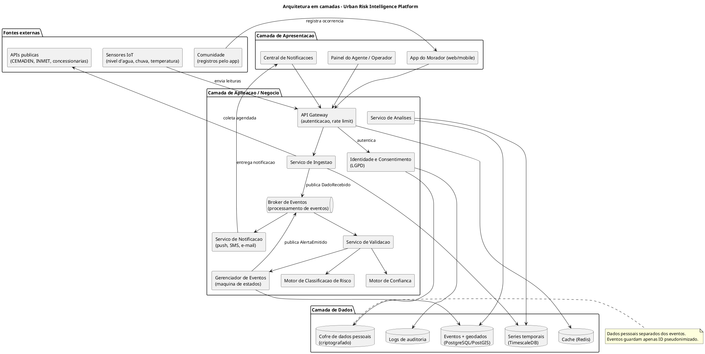
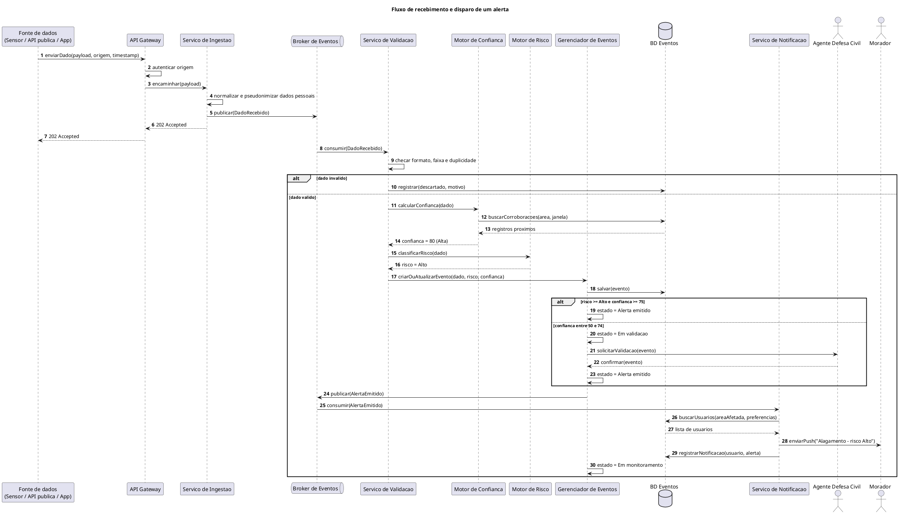
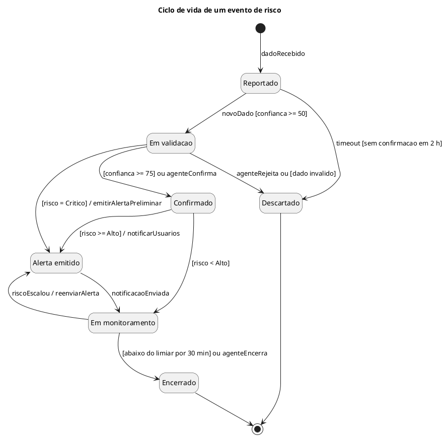

# Guia de Desenvolvimento – Urban Risk Intelligence Platform (GS 2026.2)

Engenharia de Software · Atualizado em Nov 17, 2026

## Pode usar IA? Sim, como apoio

O enunciado permite o uso de IA. A regra está em "Regras de entrega": o uso é **permitido como apoio, desde que o grupo revise e entenda tudo o que entrega**. O mesmo item avisa que **textos gerados sem revisão ou incoerentes com o protótipo serão penalizados**.

Na prática, isso significa três coisas:

- **Todo integrante precisa saber explicar** qualquer requisito, regra, diagrama ou tela. Se o professor perguntar "por que este RNF é de Confiabilidade?", alguém do grupo tem que responder sem consultar a IA.
- **Coerência é o que mais pesa.** O risco típico da IA é gerar requisitos bonitos que não aparecem no protótipo, ou diagramas com participantes que não estão na arquitetura. O próprio enunciado diz que telas sem requisito, ou requisitos sem tela, reduzem a nota.
- **Nada de texto colado sem edição.** Use a IA para rascunhar, revisar e checar. A versão final deve ser adaptada ao seu protótipo e escrita com as palavras do grupo.

A seção final deste guia ("Como usar IA de forma correta") traz prompts e um fluxo de revisão.

## Visão geral: o que entregar e onde estão os pontos

O protótipo vale 40% da nota, então ele deve receber a maior parte do tempo do grupo. A documentação vem depois, mas precisa estar completa: um protótipo funcional não compensa requisitos ou diagramas ausentes.

| Entrega                  | Pontos | O que o avaliador observa                                                                                                          |
| ------------------------ | ------ | ---------------------------------------------------------------------------------------------------------------------------------- |
| Protótipo (mín. 8 telas) | 4,0    | Telas obrigatórias, fluxos de ponta a ponta, consistência visual, usabilidade, aderência aos requisitos                            |
| Documento de requisitos  | 2,0    | RF e RNF bem escritos, RNF pela ISO 25010, cobertura de atualização, disponibilidade, escalabilidade e LGPD, regras de priorização |
| Diagrama de Sequência    | 1,0    | Notação UML correta, fluxo completo do alerta, participantes coerentes com a arquitetura                                           |
| Diagrama de Estados      | 1,0    | Notação UML correta, estados e transições coerentes                                                                                |
| Arquitetura em camadas   | 1,0    | Camadas separadas, fontes de dados, notificação e segurança posicionadas                                                           |
| Vídeo (até 3 min)        | 1,0    | Problema, solução e fluxo principal com clareza                                                                                    |

Três pontos decidem a nota:

1. **Origem e nível de confiança do dado** devem aparecer no protótipo. É o requisito central do tema; sem isso, o grupo perde pontos no critério de 4,0.
2. **Coerência entre artefatos.** Requisitos, regras, diagramas, arquitetura e telas usam os mesmos nomes e contam a mesma história.
3. **Protótipo navegável pode tirar 10.** Figma bem feito é suficiente. Um sistema funcional é valorizado, mas só vale a pena se sobrar tempo.

Formato da entrega: grupo de 1 a 3 pessoas, um único PDF enviado por um integrante pelo Teams, com links públicos do protótipo, do repositório (se houver) e do vídeo. O prazo segue o calendário oficial da FIAP.

## Plano de trabalho por fases

Siga as fases na ordem abaixo: cada uma alimenta a seguinte. Os requisitos e as regras vêm antes das telas, porque cada tela precisa apontar para um requisito. Os percentuais indicam quanto do tempo total cada fase deve ocupar.

| Fase                 | Entregas                                                  | Tempo sugerido | Responsável (trio)                      |
| -------------------- | --------------------------------------------------------- | -------------- | --------------------------------------- |
| 1. Descoberta        | Problema, público-alvo, personas                          | 10%            | Todos                                   |
| 2. Requisitos        | RF, RNF (ISO 25010), regras de risco e confiança          | 15%            | Integrante A                            |
| 3. Arquitetura e UML | Camadas, Diagrama de Sequência, Diagrama de Estados       | 15%            | Integrante B                            |
| 4. Protótipo         | 8 a 12 telas, 3 fluxos navegáveis                         | 40%            | Integrante C (A e B ajudam ao terminar) |
| 5. Revisão cruzada   | Matriz de rastreabilidade RF ↔ tela, nomes iguais em tudo | 10%            | Todos                                   |
| 6. Vídeo             | Roteiro, gravação, upload não listado                     | 5%             | Quem apresenta melhor                   |
| 7. PDF e envio       | Capa, montagem, links testados em janela anônima          | 5%             | Integrante A                            |

Para dupla, junte as fases 2 e 3 em uma pessoa e deixe a outra no protótipo. Individualmente, siga a mesma ordem e reserve pelo menos 40% do tempo para o protótipo.

Combine no início um **glossário único** (nomes dos estados, dos níveis de risco, dos serviços e das telas). Use esses nomes, sem variação, nos requisitos, nos diagramas e no protótipo.

## Etapa 1 – Problema, público-alvo e personas

Comece por uma declaração de problema curta e concreta, porque ela abre o PDF e o vídeo. Adapte o exemplo abaixo para a cidade ou o bairro que o grupo escolher; um recorte real (por exemplo, um bairro com histórico de alagamentos) deixa tudo mais convincente.

**Exemplo de declaração de problema:** moradores e agentes públicos recebem informações sobre alagamentos, calor extremo e falta de energia ou água de forma fragmentada e atrasada: grupos de mensagens, redes sociais e sites oficiais diferentes, sem indicação de quem informou nem de quão confiável é a informação. Isso atrasa decisões como sair de casa, mudar de rota ou deslocar equipes.

**Público-alvo:** moradores de áreas urbanas expostas a riscos cotidianos, agentes da Defesa Civil e operadores de serviços essenciais (energia, água, transporte).

### Personas sugeridas

| Persona                               | Perfil                                                      | Dores                                                                                       | O que a plataforma entrega                                                                         |
| ------------------------------------- | ----------------------------------------------------------- | ------------------------------------------------------------------------------------------- | -------------------------------------------------------------------------------------------------- |
| Ana, moradora                         | 34 anos, mãe, mora em rua que alaga, usa transporte público | Descobre o alagamento quando já está na rua; não sabe em que boato confiar                  | Alerta no celular para a sua região, com origem e confiança; registra ocorrências em poucos toques |
| Carlos, agente da Defesa Civil        | 45 anos, coordena equipe de campo                           | Muitos relatos duplicados ou falsos; dados de sensores e de moradores em lugares diferentes | Fila de eventos priorizada por risco e confiança; valida, confirma ou descarta eventos             |
| Juliana, operadora de serviço público | 29 anos, centro de operações da concessionária de energia   | Fica sabendo das interrupções tarde; não cruza com outros riscos                            | Painel com interrupções e riscos da área; publica status e previsão de normalização                |

Cada persona deve aparecer depois em pelo menos um requisito, um fluxo do protótipo e um participante ou ator dos diagramas.

## Etapa 2 – Requisitos funcionais

O mínimo são 10 RF, mas 14 a 17 cobrem melhor o tema e as telas. Escreva cada um no padrão "O sistema deve..." e dê a cada um identificador, descrição e prioridade. A coluna "Tela" não é obrigatória, mas ajuda a provar a coerência com o protótipo.

| ID   | Descrição                                                                                                                                 | Prioridade | Persona         | Tela                       |
| ---- | ----------------------------------------------------------------------------------------------------------------------------------------- | ---------- | --------------- | -------------------------- |
| RF01 | O sistema deve receber leituras de sensores (nível de água, chuva, temperatura) com identificação do sensor, local e horário              | Alta       | —               | Origem e confiança         |
| RF02 | O sistema deve importar periodicamente dados de bases públicas (ex.: CEMADEN, INMET, concessionárias)                                     | Alta       | —               | Origem e confiança         |
| RF03 | O sistema deve permitir que o morador registre uma ocorrência com tipo, localização, descrição e foto opcional                            | Alta       | Ana             | Registro comunitário       |
| RF04 | O sistema deve validar cada dado recebido (formato, faixa de valores, duplicidade)                                                        | Alta       | —               | Fila de validação          |
| RF05 | O sistema deve calcular o nível de confiança de cada dado conforme as regras de negócio                                                   | Alta       | Todas           | Origem e confiança         |
| RF06 | O sistema deve classificar o nível de risco de cada evento (Baixo, Moderado, Alto, Crítico)                                               | Alta       | Todas           | Detalhe do alerta          |
| RF07 | O sistema deve exibir um painel com mapa de eventos ativos, indicadores e filtros por tipo e região                                       | Alta       | Todas           | Painel                     |
| RF08 | O sistema deve listar alertas ordenados por prioridade e exibir o detalhe de cada um                                                      | Alta       | Ana, Carlos     | Lista e detalhe de alertas |
| RF09 | O sistema deve mostrar a origem (sensor, base pública ou comunidade), o horário da última atualização e o nível de confiança de cada dado | Alta       | Todas           | Origem e confiança         |
| RF10 | O sistema deve enviar notificações (push, SMS ou e-mail) aos usuários com área de interesse afetada                                       | Alta       | Ana             | Central de notificações    |
| RF11 | O sistema deve manter uma central de notificações com histórico, status lido/não lido e filtros                                           | Média      | Ana             | Central de notificações    |
| RF12 | O sistema deve permitir que o agente confirme, descarte ou encerre um evento                                                              | Alta       | Carlos          | Fila de validação          |
| RF13 | O sistema deve permitir que o usuário defina áreas de interesse e preferências de alerta                                                  | Média      | Ana             | Onboarding / Preferências  |
| RF14 | O sistema deve gerar análises históricas de eventos por tipo, região e período                                                            | Média      | Carlos, Juliana | Análises                   |
| RF15 | O sistema deve autenticar usuários e aplicar perfis de acesso (morador, agente, operador, administrador)                                  | Alta       | Todas           | Login                      |
| RF16 | O sistema deve permitir que o titular consulte, exporte e exclua seus dados pessoais e revogue consentimentos                             | Média      | Ana             | Privacidade e meus dados   |
| RF17 | O sistema deve permitir que outros moradores confirmem uma ocorrência já registrada                                                       | Baixa      | Ana             | Detalhe do alerta          |

Dicas de redação: um comportamento por requisito, sem "e/ou" ambíguo. Escreva "o que", não "como" (nada de "usando Firebase"). Use três níveis de prioridade (Alta, Média, Baixa) ou MoSCoW, e explique a escala no documento.

## Etapa 3 – Requisitos não funcionais (ISO 25010)

O mínimo são 6 RNF, e cinco temas são obrigatórios: tempo de atualização, disponibilidade, escalabilidade, usabilidade e segurança/LGPD. Cada RNF precisa de uma característica da ISO 25010 e de uma meta mensurável. "O sistema deve ser rápido" não é RNF; "atualizar em até 60 s" é.

| ID    | Característica ISO 25010 (subcaracterística)            | Requisito                                                                                                                            | Meta / métrica                                                                         |
| ----- | ------------------------------------------------------- | ------------------------------------------------------------------------------------------------------------------------------------ | -------------------------------------------------------------------------------------- |
| RNF01 | Eficiência de desempenho (Comportamento temporal)       | **Tempo de atualização:** leituras de sensores devem aparecer no painel rapidamente; bases públicas são sincronizadas periodicamente | Sensores ≤ 60 s; bases públicas a cada ≤ 15 min                                        |
| RNF02 | Eficiência de desempenho (Comportamento temporal)       | Notificações de risco Alto ou Crítico devem ser disparadas logo após a classificação                                                 | ≤ 30 s entre classificação e envio                                                     |
| RNF03 | Confiabilidade (Disponibilidade)                        | **Disponibilidade:** a plataforma deve permanecer no ar, inclusive durante chuvas fortes (pico de uso)                               | 99,5% ao mês                                                                           |
| RNF04 | Confiabilidade (Tolerância a falhas / Recuperabilidade) | Nenhum evento recebido pode ser perdido se um serviço cair; a fila reprocessa ao voltar                                              | 0 eventos perdidos; recuperação ≤ 5 min                                                |
| RNF05 | Eficiência de desempenho (Capacidade)                   | **Escalabilidade:** o sistema deve escalar horizontalmente em picos                                                                  | Suportar 10x a carga média (ex.: 5.000 eventos/min) sem passar das metas do RNF01      |
| RNF06 | Usabilidade (Operabilidade / Apreensibilidade)          | **Usabilidade:** registrar uma ocorrência deve ser simples para qualquer morador                                                     | ≤ 3 passos e ≤ 60 s; nota SUS ≥ 75 em teste com 5 usuários                             |
| RNF07 | Usabilidade (Acessibilidade)                            | Risco indicado por cor, ícone e texto (não só cor); bom contraste e leitor de tela                                                   | WCAG 2.1 nível AA                                                                      |
| RNF08 | Segurança (Confidencialidade)                           | **LGPD:** dados pessoais criptografados; localização de quem registra não é exibida com precisão no mapa público                     | TLS 1.2+ em trânsito, AES-256 em repouso; localização pública arredondada para \~100 m |
| RNF09 | Segurança (Responsabilização / Autenticidade)           | Todo acesso a dados pessoais é registrado; consentimento registrado com data e finalidade                                            | 100% dos acessos em log de auditoria; retenção definida (ex.: 12 meses)                |
| RNF10 | Compatibilidade / Portabilidade                         | Interface responsiva em navegadores de celular e desktop                                                                             | Funciona nas 2 últimas versões de Chrome, Safari e Firefox                             |

**Sobre a versão da norma:** a ISO 25010:2011, a mais usada em aula, não tem "escalabilidade" como subcaracterística. Por isso, o RNF05 usa Capacidade. A revisão de 2023 renomeou algumas características (Usabilidade virou Capacidade de Interação; Portabilidade virou Flexibilidade, que inclui Escalabilidade). Escolha uma versão, cite-a no documento e seja consistente.

**Pontos de LGPD para mencionar:** base legal do tratamento (consentimento para o morador; execução de políticas públicas para órgãos, art. 7º); minimização (coletar só o necessário); anonimização ou pseudonimização nos dados usados em análises; direitos do titular (art. 18), atendidos pelo RF16.

## Etapa 4 – Regras de negócio: risco, confiança e prioridade

O avaliador quer ver **como** risco e confiança são calculados, não só que existem. O modelo abaixo usa números simples, fáceis de explicar e de mostrar nas telas. Os limiares são exemplos didáticos: ajuste-os e diga no documento que são parâmetros configuráveis.

### 4.1 Nível de confiança do dado (0 a 100)

Cada dado começa com uma pontuação base, definida pela origem, e recebe ajustes.

| Origem                                              | Base |
| --------------------------------------------------- | ---- |
| Sensor oficial calibrado                            | 90   |
| Base pública oficial (Defesa Civil, CEMADEN, INMET) | 85   |
| Concessionária de serviço                           | 80   |
| Registro comunitário                                | 40   |

| Ajuste                                                                  | Pontos |
| ----------------------------------------------------------------------- | ------ |
| Cada confirmação de outro morador (máx. 3)                              | +10    |
| Corroborado por sensor ou base pública no raio de 500 m e em até 30 min | +15    |
| Registro com foto geolocalizada                                         | +5     |
| Dado desatualizado (mais de 2x o intervalo esperado)                    | −20    |
| Sensor com leitura fora da faixa ou falha recente                       | −30    |

Resultado limitado a 0–100. Faixas: **Alta ≥ 75**, **Média 50–74**, **Baixa < 50**.

Exemplo: um registro comunitário (40) com 2 confirmações (+20) e foto (+5) soma 65 (Média). Se um sensor próximo confirmar (+15), sobe para 80 (Alta). Mostre esse cálculo na tela de origem e confiança, porque ele explica ao usuário o porquê do nível.

### 4.2 Nível de risco do evento

| Tipo                   | Moderado                           | Alto                                          | Crítico                                          |
| ---------------------- | ---------------------------------- | --------------------------------------------- | ------------------------------------------------ |
| Alagamento             | Chuva de 10 a 25 mm/h              | Lâmina de 10 a 30 cm ou chuva de 25 a 50 mm/h | Lâmina acima de 30 cm ou chuva acima de 50 mm/h  |
| Ilha de calor          | Sensação térmica de 32 a 37 °C     | 38 a 41 °C                                    | 42 °C ou mais                                    |
| Interrupção de serviço | 2 a 6 h ou 1 mil a 10 mil afetados | Acima de 6 h ou mais de 10 mil afetados       | Atinge hospital, escola ou abastecimento crítico |

Abaixo de Moderado, o risco é Baixo.

### 4.3 Prioridade do alerta

A prioridade ordena a lista de alertas e a fila do agente. Cada nível de risco vale um peso R: Baixo = 1, Moderado = 2, Alto = 3, Crítico = 4. C é a confiança (0 a 100) e V é um bônus de vulnerabilidade (+10 se a área tiver hospital, escola ou comunidade vulnerável).

```latex
P = R \times 25 \times \frac{C}{100} + V
```

Exemplo: alagamento Alto (R = 3) com confiança 80 perto de uma escola dá P = 3 × 25 × 0,8 + 10 = 70.

### 4.4 Regras de negócio

| ID   | Regra                                                                                                                                                        |
| ---- | ------------------------------------------------------------------------------------------------------------------------------------------------------------ |
| RN01 | O alerta público é emitido automaticamente apenas quando risco ≥ Alto e confiança ≥ 75                                                                       |
| RN02 | Com confiança entre 50 e 74, o evento vai para a fila de validação do agente; se o risco for Crítico, sai um alerta preliminar marcado como "não confirmado" |
| RN03 | Com confiança < 50, o evento fica como Reportado esperando confirmações e é descartado se não houver nenhuma em 2 h                                          |
| RN04 | Registros do mesmo tipo a até 300 m e 60 min um do outro são agrupados no mesmo evento                                                                       |
| RN05 | O evento é encerrado quando os valores ficam abaixo do limiar por 30 min seguidos ou quando o agente o encerra                                               |
| RN06 | Só recebe notificação quem tem área de interesse no raio afetado; o mesmo evento não é renotificado em menos de 15 min, salvo se o risco subir               |

Essas regras são as condições (guardas) do Diagrama de Estados e os blocos `alt` do Diagrama de Sequência. Use os mesmos números nos três lugares.

## Etapa 5 – Arquitetura em camadas

A arquitetura tem três camadas (apresentação, aplicação/negócio e dados) alimentadas por três fontes externas. O enunciado pede que fique claro onde estão a **notificação**, o **processamento de eventos** e a **proteção de dados pessoais**; a tabela marca os três.

| Camada              | Componentes                                                                                                                                                                                                                                                                                                                       | Responsabilidade                                                |
| ------------------- | --------------------------------------------------------------------------------------------------------------------------------------------------------------------------------------------------------------------------------------------------------------------------------------------------------------------------------- | --------------------------------------------------------------- |
| Fontes externas     | Sensores IoT, APIs públicas (CEMADEN, INMET, concessionárias), Comunidade (app)                                                                                                                                                                                                                                                   | Produzem os dados brutos                                        |
| Apresentação        | App do morador (web/mobile), Painel do agente/operador, Central de notificações                                                                                                                                                                                                                                                   | Telas do protótipo                                              |
| Aplicação / negócio | API Gateway (autenticação, limite de requisições); Serviço de Ingestão; **Broker de Eventos** (Kafka ou RabbitMQ); Serviço de Validação; Motor de Confiança; Motor de Classificação de Risco; Gerenciador de Eventos (máquina de estados); **Serviço de Notificação**; Serviço de Análises; **Identidade e Consentimento (LGPD)** | Regras de negócio, processamento assíncrono de eventos, alertas |
| Dados               | Eventos e geodados (PostgreSQL + PostGIS); Séries temporais (TimescaleDB); **Cofre de dados pessoais** (separado e criptografado); Logs de auditoria; Cache (Redis)                                                                                                                                                               | Persistência                                                    |
| Transversal         | Criptografia, controle de acesso por perfil, anonimização na ingestão, monitoramento                                                                                                                                                                                                                                              | Segurança e LGPD em todas as camadas                            |

Por que essa escolha atende aos RNF: o broker desacopla ingestão e processamento, o que dá escalabilidade (RNF05) e garante que nada se perca se um serviço cair (RNF04). O cache e os serviços independentes sustentam o tempo de atualização (RNF01) e a disponibilidade (RNF03). Separar o cofre de dados pessoais dos eventos atende à LGPD (RNF08 e RNF09).

Código para gerar o diagrama em [PlantUML](https://www.plantuml.com/plantuml) (cole no site ou use a extensão do VS Code):



Os acentos foram omitidos no código para evitar erros de codificação em algumas ferramentas. Se a sua aceitar UTF-8, pode colocá-los. Alternativas visuais: draw.io (diagrams.net), Lucidchart ou o próprio Figma.

## Etapa 6 – Diagrama de Sequência do alerta

O diagrama precisa mostrar o fluxo inteiro: **dado recebido → validação → classificação de risco → notificação ao usuário**. Os participantes devem ser exatamente os componentes da arquitetura da Etapa 5, com os mesmos nomes.

Checklist de notação UML que o avaliador confere:

- Atores (boneco) para pessoas; participantes (retângulos) para componentes; banco de dados com o símbolo `database`.
- Seta cheia (`->`) para chamada; tracejada (`-->`) para retorno.
- Fragmentos `alt` para decisões (dado inválido, confiança baixa ou alta) e `opt` para passos opcionais.
- Mensagens com nome de operação e parâmetros, por exemplo `calcularConfianca(dado)`.



O `alt` interno espelha as regras RN01 e RN02, e os estados citados são os do Diagrama de Estados. Assim, os artefatos se conectam. Se o tempo permitir, faça uma versão partindo de um registro comunitário, que é o fluxo que aparece no vídeo.

## Etapa 7 – Diagrama de Estados do evento de risco

O ciclo de vida sugerido pelo enunciado tem sete estados: Reportado, Em validação, Confirmado, Alerta emitido, Em monitoramento, Encerrado e Descartado. Cada transição deve ter **evento**, **\[condição\]** e, quando houver, **/ ação**, no formato UML `evento [guarda] / acao`.

| De               | Para             | Evento \[condição\] / ação                       | Regra      |
| ---------------- | ---------------- | ------------------------------------------------ | ---------- |
| Início           | Reportado        | dadoRecebido                                     | —          |
| Reportado        | Em validação     | novoDado \[confiança ≥ 50\]                      | RN02, RN03 |
| Reportado        | Descartado       | timeout \[sem confirmação em 2 h\]               | RN03       |
| Em validação     | Confirmado       | \[confiança ≥ 75\] ou agenteConfirma             | RN01       |
| Em validação     | Alerta emitido   | \[risco = Crítico\] / emitir alerta preliminar   | RN02       |
| Em validação     | Descartado       | agenteRejeita ou \[dado inválido\]               | —          |
| Confirmado       | Alerta emitido   | \[risco ≥ Alto\] / notificarUsuarios             | RN01, RN06 |
| Confirmado       | Em monitoramento | \[risco < Alto\]                                 | —          |
| Alerta emitido   | Em monitoramento | notificacaoEnviada                               | —          |
| Em monitoramento | Alerta emitido   | riscoEscalou / reenviarAlerta                    | RN06       |
| Em monitoramento | Encerrado        | \[abaixo do limiar por 30 min\] ou agenteEncerra | RN05       |



Erros comuns que tiram ponto: esquecer o estado inicial (●) ou os finais (◉); estado sem saída; transição sem rótulo; e confundir estado ("Em validação") com ação ("Validar"). O protótipo deve exibir esses mesmos estados como etiquetas de status nos alertas e na fila do agente.

## Etapa 8 – Protótipo: telas, fluxos e rastreabilidade

O protótipo vale 4,0 pontos. Planeje de 10 a 12 telas para ter folga sobre o mínimo de 8, garantindo as cinco obrigatórias. Cada tela aponta para pelo menos um RF; essa tabela já é a matriz de rastreabilidade que vai no PDF.

| #   | Tela                       | Conteúdo principal                                                                              | RF               | Obrigatória |
| --- | -------------------------- | ----------------------------------------------------------------------------------------------- | ---------------- | ----------- |
| 1   | Login / Cadastro           | Perfil (morador, agente, operador), aceite de termos e consentimento LGPD explícito             | RF15, RF16       | —           |
| 2   | Onboarding / Preferências  | Áreas de interesse no mapa, tipos de risco e canais de alerta                                   | RF13             | —           |
| 3   | Painel de acompanhamento   | Mapa com eventos coloridos por risco, indicadores (alertas ativos, última atualização), filtros | RF07             | Sim         |
| 4   | Lista de alertas           | Cards ordenados por prioridade, com risco, estado, origem e confiança resumidos                 | RF08             | Sim         |
| 5   | Detalhe do alerta          | Descrição, mapa, linha do tempo de estados, recomendações, botão "Também vejo isso"             | RF06, RF08, RF17 | Sim         |
| 6   | Origem e confiança do dado | Fontes (sensor, base pública, comunidade), horário, nível de confiança com o cálculo explicado  | RF05, RF09       | Sim         |
| 7   | Central de notificações    | Histórico, lidas e não lidas, filtros por tipo, link para o alerta                              | RF10, RF11       | Sim         |
| 8   | Registro comunitário       | Tipo, localização automática, descrição, foto, envio em até 3 passos                            | RF03             | Sim         |
| 9   | Meus registros             | Status de cada registro (Reportado, Em validação, Confirmado...) e confirmações recebidas       | RF03, RF17       | —           |
| 10  | Fila de validação (agente) | Eventos por prioridade com botões Confirmar, Descartar e Encerrar                               | RF04, RF12       | —           |
| 11  | Análises                   | Gráficos por tipo, região e período; tempo médio de atualização                                 | RF14             | —           |
| 12  | Privacidade e meus dados   | Consentimentos, exportar dados, excluir conta                                                   | RF16             | —           |

RF01 e RF02 não têm tela própria porque são integrações automáticas. Eles aparecem nas telas 3 e 6 como origem dos dados; explique isso em uma linha no PDF.

### Fluxos que precisam navegar de ponta a ponta

1. **Morador recebe alerta:** notificação push → Central de notificações → Detalhe do alerta → Origem e confiança → volta ao Painel.
2. **Morador registra ocorrência:** Painel → Registro comunitário → confirmação de envio → Meus registros (status "Reportado" e depois "Em validação").
3. **Agente valida evento:** Login como agente → Fila de validação → Detalhe → Confirmar → estado muda para "Alerta emitido".

### Como mostrar origem e confiança (o diferencial do tema)

- **Selo de origem** em todo card e detalhe: ícone e texto ("Sensor", "Base pública – CEMADEN", "Comunidade – 3 confirmações").
- **Selo de confiança** com faixa e número ("Alta • 82"), clicável, levando à tela 6.
- **Carimbo de atualização** ("atualizado há 40 s"), que materializa o indicador de tempo de atualização.
- Na tela 6, a decomposição do cálculo (base 40 + confirmações 20 + foto 5 + sensor 15 = 80), igual à Etapa 4.

### Consistência visual e usabilidade

- Defina antes um mini design system: paleta, 2 fontes, espaçamentos, componentes (card, selo, botão, barra de navegação).
- Escala de risco com cor, ícone e texto: Baixo (verde), Moderado (amarelo), Alto (laranja), Crítico (vermelho). Nunca só cor, por acessibilidade (RNF07).
- Mesma navegação inferior em todas as telas do morador: Painel, Alertas, Registrar, Notificações, Perfil.
- Use dados realistas: nomes de bairros, horários, valores em mm/h e °C. Lorem ipsum passa a impressão de protótipo inacabado.

### No Figma

Use componentes e variantes para os selos e cards, e Prototype com conexões em todos os botões dos 3 fluxos. Para a notificação push, use um overlay. Compartilhe como "qualquer pessoa com o link pode ver" e teste o link do protótipo (modo apresentação) em uma janela anônima.

## Etapa 9 – Se o grupo optar por protótipo funcional

Faça o sistema funcional só se o grupo já tiver as telas desenhadas e os documentos prontos; caso contrário, Figma é a aposta mais segura. A forma mais rápida é um front-end com dados simulados, sem back-end real.

| Opção           | Stack                                                       | Quando escolher                        | Deploy gratuito                 |
| --------------- | ----------------------------------------------------------- | -------------------------------------- | ------------------------------- |
| A (recomendada) | React + Vite + Leaflet (mapa OpenStreetMap) + JSON simulado | O grupo conhece JavaScript             | Vercel, Netlify ou GitHub Pages |
| B               | Python + Streamlit + Folium                                 | O grupo conhece Python                 | Streamlit Community Cloud       |
| C               | React no front + FastAPI no back + SQLite                   | Quer mostrar camadas reais e tem tempo | Front no Vercel, API no Render  |

Dicas para a opção A:

- Um `setInterval` que gera novas leituras de sensor a cada 10–30 s simula a atualização em tempo real e faz o "atualizado há X s" mudar na demonstração.
- Implemente as funções `calcularConfianca()` e `classificarRisco()` exatamente com as regras da Etapa 4. Isso prova a coerência entre documento e sistema.
- Organize as pastas espelhando as camadas: `src/pages` (apresentação), `src/services` (regras de negócio), `src/data` (dados simulados).

**README mínimo do repositório:** nome e descrição do projeto; integrantes e RMs; link do deploy e do vídeo; tecnologias usadas; como rodar (`npm install` e `npm run dev`, ou `pip install -r requirements.txt` e `streamlit run app.py`); lista de telas e fluxos; e o aviso de que os dados são simulados. Deixe o repositório público.

## Etapa 10 – Roteiro do vídeo (até 3 minutos)

O vídeo vale 1,0 ponto e precisa mostrar três coisas: problema, solução e navegação pelo fluxo principal. Escreva o roteiro, ensaie uma vez com cronômetro e mire em 2:45, para não estourar.

| Tempo     | Conteúdo                                                                 | Na tela                                                |
| --------- | ------------------------------------------------------------------------ | ------------------------------------------------------ |
| 0:00–0:20 | Problema: informação de risco fragmentada, atrasada e sem confiabilidade | Slide ou foto de rua alagada, com uma frase de impacto |
| 0:20–0:40 | Solução e para quem: a plataforma e as 3 personas                        | Slide com as personas                                  |
| 0:40–1:40 | Fluxo 1: Ana recebe o alerta, abre o detalhe e vê origem e confiança     | Protótipo                                              |
| 1:40–2:10 | Fluxo 2: Ana registra uma ocorrência e acompanha o status                | Protótipo                                              |
| 2:10–2:35 | Fluxo 3: Carlos valida o evento e o alerta é emitido                     | Protótipo                                              |
| 2:35–2:55 | Arquitetura e LGPD em 2 frases                                           | Imagem da arquitetura                                  |
| 2:55–3:00 | Fechamento com o nome da solução                                         | Tela final                                             |

Ferramentas: OBS Studio (gratuito) ou Loom para gravar a tela, e CapCut ou Clipchamp para cortar. Use um microfone de fone de ouvido em ambiente silencioso. Publique no YouTube como **não listado** (não privado) e teste o link em janela anônima.

## Montagem do PDF final e checklist

A entrega é um único PDF com a documentação. A primeira página é obrigatória e tem de conter nomes completos, RMs e todos os links.

Estrutura sugerida:

1. **Capa:** título, nomes completos e RMs, links do protótipo, do repositório (se houver) e do vídeo.
2. Problema, público-alvo e personas.
3. Requisitos funcionais (tabela).
4. Requisitos não funcionais com a classificação ISO 25010 (citando a versão).
5. Regras de negócio: confiança, risco, prioridade e RN01–RN06.
6. Arquitetura em camadas: diagrama e explicação curta.
7. Diagrama de Sequência.
8. Diagrama de Estados com a tabela de transições.
9. Matriz de rastreabilidade RF ↔ tela (opcional, mas mostra a coerência).
10. Prints das telas principais (opcional).

Exporte os diagramas em PNG ou SVG de boa resolução. Um diagrama ilegível no PDF pode custar ponto de notação.

### Checklist antes de enviar

- [ ] Nomes completos e RMs de todos na primeira página
- [ ] Problema, público-alvo e personas descritos
- [ ] Pelo menos 10 RF com ID, descrição e prioridade
- [ ] Pelo menos 6 RNF na ISO 25010, cobrindo atualização, disponibilidade, escalabilidade, usabilidade e LGPD
- [ ] Regras de priorização de alertas e de nível de confiança
- [ ] Diagrama de Sequência com o fluxo completo do alerta
- [ ] Diagrama de Estados com eventos e condições
- [ ] Arquitetura em camadas com notificação, processamento de eventos e LGPD posicionados
- [ ] Protótipo com pelo menos 8 telas, incluindo as 5 obrigatórias
- [ ] Origem e nível de confiança visíveis no protótipo
- [ ] Os 3 fluxos navegáveis de ponta a ponta
- [ ] Nomes de estados, níveis e serviços iguais em todos os artefatos
- [ ] Todo RF tem tela (ou justificativa) e toda tela tem RF
- [ ] Links públicos testados em janela anônima
- [ ] Vídeo de até 3 minutos, não listado
- [ ] README com instruções (se protótipo funcional)
- [ ] Um integrante envia pelo Teams, em nome do grupo, dentro do prazo da FIAP

## Como usar IA de forma correta neste projeto

A IA é permitida como apoio. Use-a para acelerar rascunhos e para revisar, e deixe as decisões e a versão final com o grupo.

| Uso                   | Bom uso                                                                | Evite                                          |
| --------------------- | ---------------------------------------------------------------------- | ---------------------------------------------- |
| Personas e problema   | Gerar ideias e depois escolher e adaptar ao seu recorte                | Personas genéricas que não aparecem nos fluxos |
| Requisitos            | Revisar redação, ambiguidade e classificação ISO 25010                 | Colar 30 RF que não têm tela                   |
| Diagramas             | Rascunhar o código PlantUML e corrigir erros de sintaxe                | Participantes que não existem na arquitetura   |
| Protótipo             | Textos de interface, dados fictícios realistas, revisão de usabilidade | Telas fora do padrão visual do resto           |
| Código (se funcional) | Gerar componentes e depurar, entendendo cada arquivo                   | Código que ninguém do grupo sabe explicar      |

### Fluxo de revisão recomendado

1. Gere o rascunho com IA.
2. Um integrante adapta ao glossário e ao protótipo do grupo.
3. Outro integrante confere a coerência: RF ↔ tela, regra ↔ diagrama, componente ↔ participante.
4. Cada pessoa explica em voz alta uma parte que não escreveu. Se travar, a parte precisa ser revista.

### Prompts úteis

- "Aqui estão meus RF e a lista das minhas telas. Aponte RF sem tela e telas sem RF."
- "Revise estes RNF: cada um tem característica ISO 25010:2011 correta e meta mensurável? Sugira correções sem mudar o escopo."
- "Este código PlantUML de diagrama de estados tem erro de sintaxe ou de notação UML? Os estados batem com estas regras de negócio: \[cole RN01–RN06\]."
- "Avalie a usabilidade desta tela \[print\] para uma moradora de 34 anos com pouco tempo, considerando WCAG AA."
- "Faça perguntas como se fosse o professor avaliando este diagrama de sequência." (ótimo para treinar a apresentação)

Boa prática opcional: incluir no PDF uma linha como "Ferramentas de IA foram usadas como apoio na revisão de textos e na geração de rascunhos dos diagramas; todo o conteúdo foi revisado pelo grupo." O enunciado não exige isso, mas mostra transparência.

## Trabalhando sozinho com o Claude Code

Sozinho, a melhor estratégia é colocar **tudo em um único repositório**: documentação em Markdown, diagramas em PlantUML e o protótipo funcional em React. Assim, o Claude Code enxerga todos os artefatos ao mesmo tempo e consegue conferir a coerência entre eles, que é o ponto que mais tira nota.

Por que um protótipo funcional, e não Figma, neste caso: com o Claude Code, construir as telas em código leva um tempo parecido com desenhá-las no Figma. Além disso, o sistema funcional é valorizado na fidelidade, e as regras de risco e confiança viram funções de verdade. A condição é você entender o código. Se não tiver familiaridade mínima com JavaScript, fique com o Figma: a nota máxima continua possível, e o Claude Code segue útil para documentos e diagramas.

| Peso | Artefato                | Onde fica no repositório        | Papel do Claude Code                                           |
| ---- | ----------------------- | ------------------------------- | -------------------------------------------------------------- |
| 4,0  | Protótipo               | `app/` (React + Vite + Leaflet) | Gera telas e componentes, simula dados e verifica no navegador |
| 2,0  | Requisitos e regras     | `docs/01-requisitos.md`         | Rascunha, revisa a redação e checa a classificação ISO 25010   |
| 3,0  | Diagramas e arquitetura | `docs/diagramas/*.puml`         | Escreve o PlantUML, renderiza e corrige                        |
| 1,0  | Vídeo                   | `docs/roteiro-video.md`         | Escreve o roteiro a partir dos fluxos reais                    |
| —    | PDF final               | `entrega/`                      | Monta o PDF a partir dos Markdown (Pandoc)                     |

Divisão de tempo para quem trabalha sozinho: cerca de 25% em requisitos, regras e diagramas, 50% no protótipo, 15% em revisão de coerência e 10% em vídeo e PDF.

## Instalação e configuração

Para usar o Claude Code, você precisa de uma assinatura paga do Claude (Pro ou superior) ou de uma conta no Claude Console. Ele roda no terminal, no VS Code e no app desktop; para este projeto, o **VS Code com a extensão** é o mais confortável, porque mostra as alterações lado a lado antes de você aceitar ([documentação](https://code.claude.com/docs/en/vs-code)).

1. **Instale os pré-requisitos:** [Node.js LTS](https://nodejs.org), [Git](https://git-scm.com) (no Windows, o Git for Windows também permite que o Claude Code use Bash) e [VS Code](https://code.visualstudio.com).
2. **Instale o Claude Code** ([quickstart oficial](https://code.claude.com/docs/en/quickstart)):
   - macOS, Linux ou WSL: `curl -fsSL https://claude.ai/install.sh | bash`
   - Windows PowerShell: `irm https://claude.ai/install.ps1 | iex`
   - Confira com `claude --version` em um terminal novo.
3. **Instale a extensão** no VS Code: Extensões (Ctrl+Shift+X), pesquise "Claude Code" e instale. Na primeira vez, faça login com sua conta Claude.
4. **Crie o repositório** no GitHub (público), clone na sua máquina e abra a pasta no VS Code.
5. **Coloque o enunciado e o CLAUDE.md na pasta:** salve o PDF do enunciado em `docs/enunciado.pdf` e o arquivo `CLAUDE.md` que te enviei na raiz.

Ferramentas de apoio:

| Ferramenta                        | Para quê                                                                          | Instalação                                                                                                                       |
| --------------------------------- | --------------------------------------------------------------------------------- | -------------------------------------------------------------------------------------------------------------------------------- |
| Extensão PlantUML (VS Code)       | Pré-visualizar e exportar os diagramas (Alt+D)                                    | Extensões → "PlantUML" (requer Java)                                                                                             |
| Java (JRE 17+)                    | Necessário para renderizar PlantUML localmente                                    | [adoptium.net](https://adoptium.net)                                                                                             |
| Pandoc                            | Converter os Markdown da documentação em PDF                                      | [pandoc.org](https://pandoc.org/installing.html)                                                                                 |
| Vercel                            | Deploy gratuito do protótipo com link público                                     | Login com GitHub em [vercel.com](https://vercel.com)                                                                             |
| OBS Studio                        | Gravar o vídeo de demonstração                                                    | [obsproject.com](https://obsproject.com)                                                                                         |
| Figma + plugin oficial (opcional) | Só se escolher protótipo navegável: o Claude Code passa a ler o seu arquivo Figma | `claude plugin install figma@claude-plugins-official` ([guia da Figma](https://help.figma.com/hc/en-us/articles/39888612464151)) |

Se nunca usou terminal, a Anthropic tem um [guia para iniciantes](https://code.claude.com/docs/en/terminal-guide) e o curso gratuito [Claude Code 101](https://academy.claude.com/courses/claude-code-101). Vale reservar uma hora para ele antes de começar.

## Estrutura do repositório e o arquivo CLAUDE.md

O Claude Code começa cada sessão do zero; o que ele sempre lê é o `CLAUDE.md` na raiz do projeto. Por isso, o arquivo que te enviei já traz o que o código não mostra: o que a disciplina pede, o peso de cada entrega, o glossário, as regras RN01–RN06 e como você quer que ele trabalhe (em português, explicando cada mudança, sem inventar requisitos). Mantenha-o curto e atualize quando decidir algo novo ([como a memória funciona](https://code.claude.com/docs/en/memory)).

```plain text
urban-risk-platform/
├── CLAUDE.md                     ← contexto permanente do projeto
├── .claude/skills/checar-coerencia/SKILL.md   ← comando /checar-coerencia
├── README.md
├── docs/
│   ├── enunciado.pdf
│   ├── 00-problema-personas.md
│   ├── 01-requisitos.md          ← RF, RNF, regras de negócio
│   ├── 02-arquitetura.md
│   ├── roteiro-video.md
│   └── diagramas/
│       ├── arquitetura.puml
│       ├── sequencia.puml
│       └── estados.puml
├── app/                          ← protótipo React + Vite
│   └── src/{pages,components,services,data}
└── entrega/                      ← PDF final
```

Arquivos que te enviei junto com este guia:

- `CLAUDE.md`: coloque na raiz.
- `checar-coerencia/SKILL.md`: coloque em `.claude/skills/checar-coerencia/SKILL.md`. Depois disso, digitar `/checar-coerencia` no Claude Code faz uma auditoria completa (RF ↔ tela, regras ↔ código, estados ↔ telas, glossário) sem editar nada.
- `arquitetura.puml`, `sequencia.puml` e `estados.puml`: os diagramas deste guia, já testados. Coloque em `docs/diagramas/`.

Faça o primeiro commit com essa estrutura antes de pedir qualquer código. A partir daí, cada fase termina em um commit, o que deixa você voltar atrás com segurança.

## Roteiro de sessões com prompts prontos

Cada sessão abaixo é uma conversa separada no Claude Code. Use `/clear` entre elas, porque um contexto focado gera respostas melhores, e termine cada uma com um commit. Nas sessões grandes, comece em **modo plano** (`/plan`): o Claude Code descreve o que vai fazer e espera sua aprovação antes de mexer em arquivos.

### Sessão 1 – Problema, personas e requisitos

```text
Leia o CLAUDE.md e o docs/enunciado.pdf. Crie docs/00-problema-personas.md e
docs/01-requisitos.md usando o glossário e as regras do CLAUDE.md: problema,
público-alvo, 3 personas, 17 RF (ID, descrição, prioridade, persona, tela),
10 RNF classificados pela ISO 25010:2011 com meta mensurável e as regras de
negócio (confiança, risco, prioridade, RN01–RN06). Recorte: bairro de [SUA
CIDADE/BAIRRO]. No fim, liste as decisões que você tomou para eu revisar.
```

Depois, revise cada RF e RNF você mesmo. Peça: "Explique por que o RNF05 é Capacidade e não Escalabilidade na ISO 25010:2011". Se não conseguir repetir a explicação com suas palavras, estude antes de seguir.

### Sessão 2 – Arquitetura e diagramas

```text
Copiei para docs/diagramas/ os arquivos arquitetura.puml, sequencia.puml e
estados.puml. Confira se estão coerentes com docs/01-requisitos.md e com o
glossário, corrija o que não bater, renderize os três em PNG e escreva
docs/02-arquitetura.md explicando as camadas e onde ficam notificação,
processamento de eventos e proteção de dados pessoais.
```

### Sessão 3 – Base do protótipo e regras de negócio (modo plano)

```text
/plan Crie o protótipo em app/ com React + Vite + React Router + Leaflet.
Comece pela base: dados simulados em src/data (eventos com origem, confiança,
risco e estado, em bairros reais de [CIDADE]), as funções calcularConfianca,
classificarRisco e calcularPrioridade em src/services exatamente como no
CLAUDE.md (com testes simples em Vitest) e um simulador que gera novas
leituras de sensor a cada 15 s. Ainda sem telas. Explique a estrutura antes
de criar.
```

### Sessões 4 a 6 – Telas, uma por fluxo

Peça as telas por fluxo, e não todas de uma vez, para revisar cada parte.

```text
Crie o fluxo 1 (Ana recebe alerta): Painel com mapa e indicadores → Central
de notificações → Detalhe do alerta → Origem e confiança (com a decomposição
do cálculo). Siga os padrões visuais do CLAUDE.md. Depois rode o app,
abra no navegador, navegue pelo fluxo inteiro e me mostre um print de cada tela.
```

- Sessão 5: fluxo 2 (Registro comunitário → confirmação → Meus registros).
- Sessão 6: fluxo 3 (Login como agente → Fila de validação → Confirmar → estado vira "Alerta emitido"), mais Login, Preferências, Análises e Privacidade.

Se uma tela ficar estranha, cole o print no Claude Code e diga o que quer mudar. Imagens funcionam melhor do que descrições.

### Sessão 7 – Revisão de coerência

Rode `/checar-coerencia`. Corrija o que for apontado, do maior impacto para o menor. Depois peça uma revisão independente com `/code-review`, que analisa as mudanças com um agente que não viu a conversa.

### Sessão 8 – Deploy, README, vídeo e PDF

```text
1. Escreva o README.md (descrição, meu nome e RM, links, tecnologias, como
   rodar, telas e fluxos, aviso de dados simulados).
2. Prepare o app para deploy na Vercel e me diga os passos que só eu posso fazer.
3. Escreva docs/roteiro-video.md com 2:45 de duração, seguindo os fluxos reais.
4. Gere entrega/documentacao.pdf com Pandoc a partir de docs/*.md, com capa
   (meu nome completo, RM e os links) e os PNG dos diagramas.
```

Antes de enviar, abra o PDF e confira cada item do checklist. Teste os três links em uma janela anônima.

## Recursos do Claude Code que mais ajudam

Você não precisa conhecer tudo: estes comandos cobrem quase todo o projeto. Digite `/` dentro do Claude Code para ver a lista completa ([referência de comandos](https://code.claude.com/docs/en/commands)).

| Comando / atalho                | O que faz                                                         | Quando usar aqui                                                             |
| ------------------------------- | ----------------------------------------------------------------- | ---------------------------------------------------------------------------- |
| `/init` e `/memory`             | Cria e edita o CLAUDE.md                                          | Só se quiser recomeçar o arquivo; o que te enviei já serve                   |
| `/plan`                         | Descreve o plano e espera aprovação antes de alterar arquivos     | Sessões 3 a 6, antes de criar telas e serviços                               |
| `Esc`                           | Interrompe no meio da ação, sem perder o que já foi feito         | Quando ele começar a seguir na direção errada                                |
| `/rewind` (ou `Esc` duas vezes) | Volta código e conversa a um ponto anterior                       | Testar uma ideia de tela e desfazer se não gostar                            |
| `/clear`                        | Começa uma conversa limpa                                         | Entre sessões, ou depois de 2 correções que não funcionaram                  |
| `/rename` e `claude --resume`   | Nomeia a sessão e a retoma depois                                 | Trabalho espalhado por vários dias                                           |
| `Shift+Tab`                     | Alterna o modo de permissão (quanto ele pode fazer sem perguntar) | No início, deixe-o perguntar antes de editar, para aprender com cada mudança |
| `/verify`                       | Compila, roda o app e olha o resultado                            | Ao terminar cada fluxo de telas                                              |
| `/code-review`                  | Revisa as mudanças com um agente que não viu a conversa           | Sessão 7                                                                     |
| `/checar-coerencia`             | Seu comando personalizado: auditoria entre os artefatos           | Antes de cada commit grande e antes do PDF                                   |
| `/usage`                        | Mostra quanto do limite do plano você já usou                     | Para não ficar sem cota perto do prazo                                       |

Três hábitos fazem mais diferença do que qualquer comando:

1. **Seja específico.** Diga o arquivo, a tela e como "pronto" se parece: "na tela de detalhe, o selo de confiança deve abrir a tela de origem" funciona melhor do que "melhore o detalhe".
2. **Peça evidência.** "Rode o build e mostre a saída" ou "abra no navegador e me mostre o print". Não aceite apenas "pronto, funciona".
3. **Mande imagens.** Um print da tela ou um rascunho à mão fotografado comunica layout melhor do que um parágrafo.

## Cuidados para usar o Claude Code dentro da regra

O enunciado penaliza textos sem revisão e incoerências com o protótipo. Com o Claude Code fazendo boa parte do trabalho, o risco real é entregar algo que você não sabe explicar.

- **Leia cada alteração antes de aceitar**, principalmente as regras de negócio em `src/services/`. Elas são o coração do trabalho e as mais prováveis de render perguntas.
- **Ao fim de cada sessão, peça:** "Me faça 5 perguntas como se fosse o professor avaliando o que fizemos hoje". Responda sem consultar.
- **Toda decisão nova vai para o CLAUDE.md e para o documento de requisitos ao mesmo tempo.** Isso evita que código e documento divirjam.
- **Commits pequenos e frequentes**, com mensagens claras. O histórico do GitHub também mostra que o trabalho foi construído e revisado por etapas.
- **Não deixe o escopo crescer.** O Claude Code tende a sugerir funcionalidades extras. Cada tela a mais precisa de um RF e entra na revisão de coerência; 10 a 12 telas bem feitas valem mais do que 20 rasas.
- **Não cole dados pessoais reais** (seus ou de terceiros) nos prompts nem nos dados simulados. Use nomes e endereços fictícios, coerentes com a própria regra de LGPD do projeto.
- **Reserve folga de cota e de tempo.** O plano Pro tem limite de uso. Deixe as sessões pesadas (telas) para o início e acompanhe com `/usage`.

Sugestão de linha para o PDF: "Ferramentas de IA (Claude Code) foram usadas como apoio na geração de rascunhos, código e diagramas; todo o conteúdo foi revisado e validado pelo autor."
